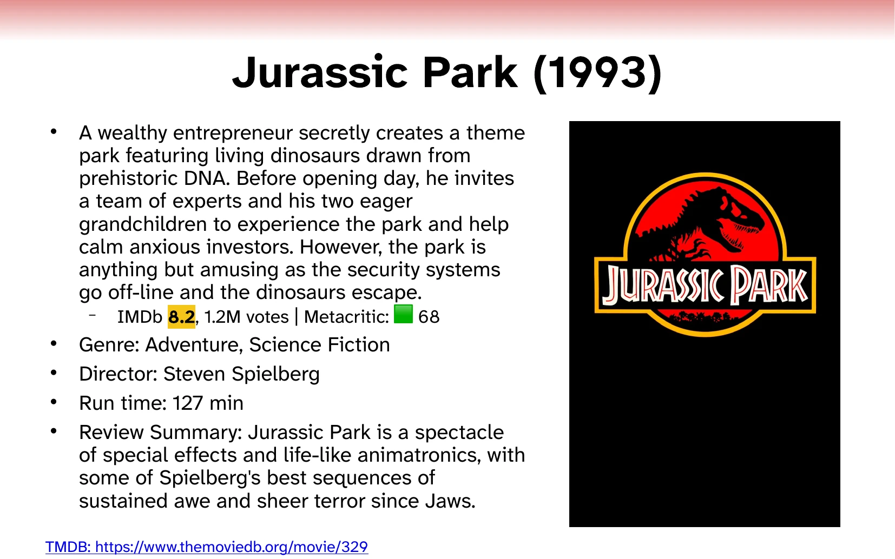
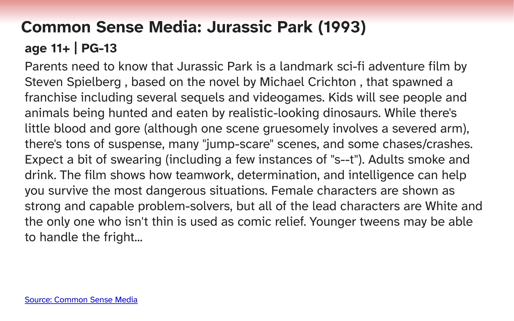
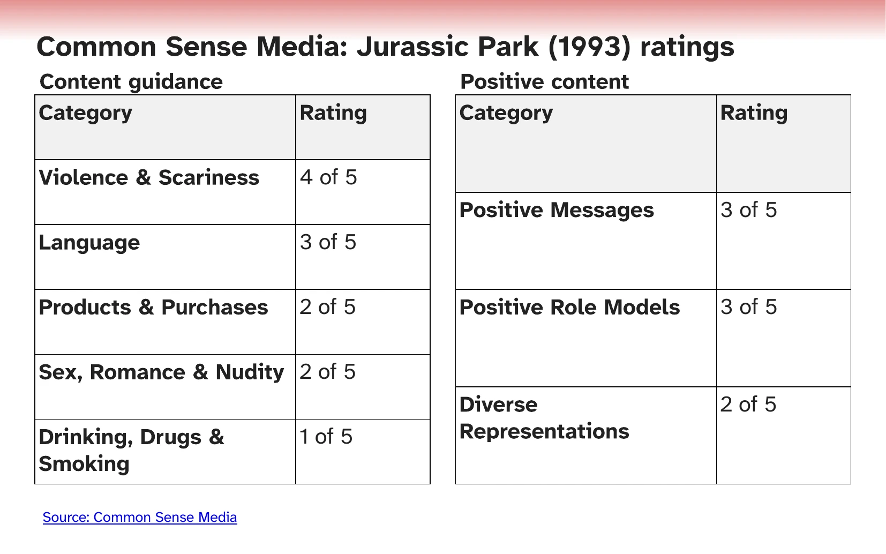
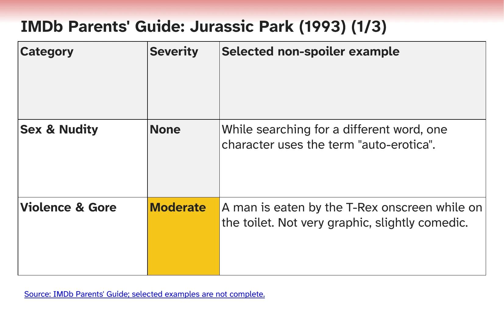
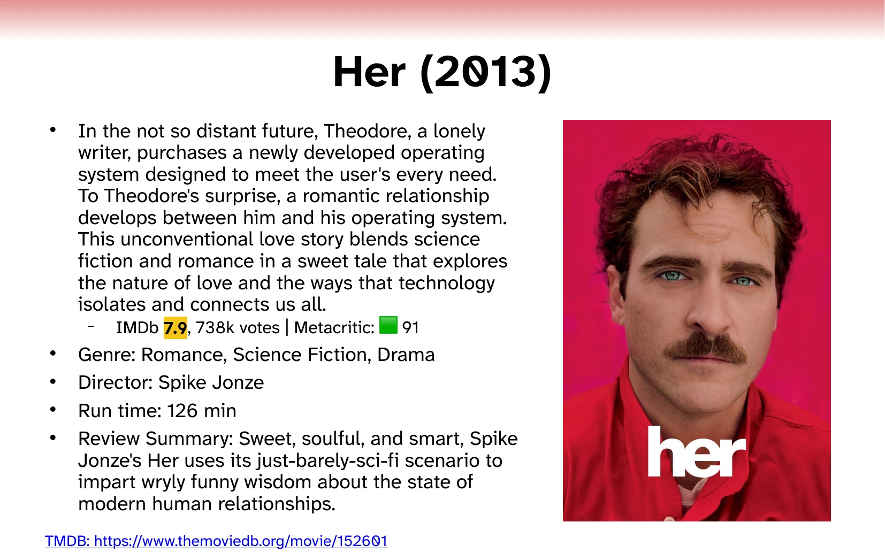
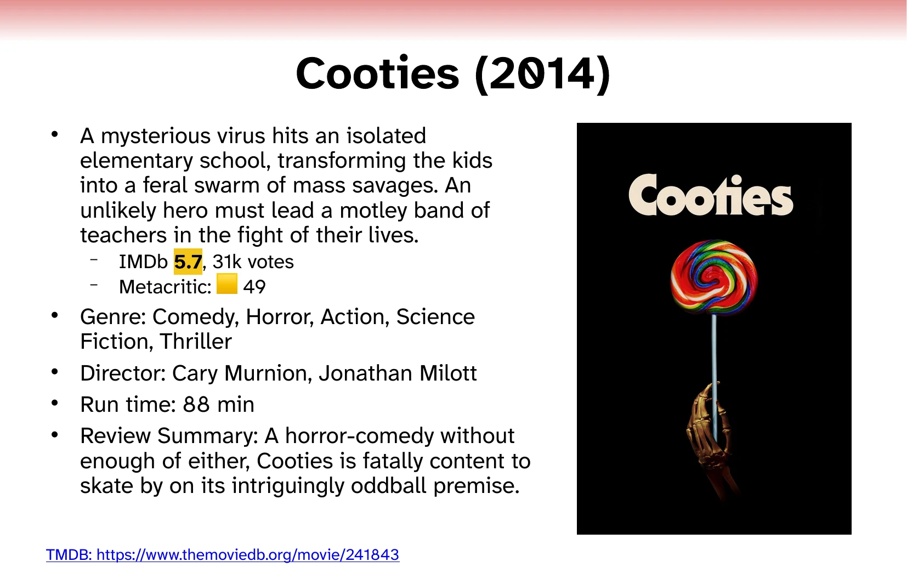
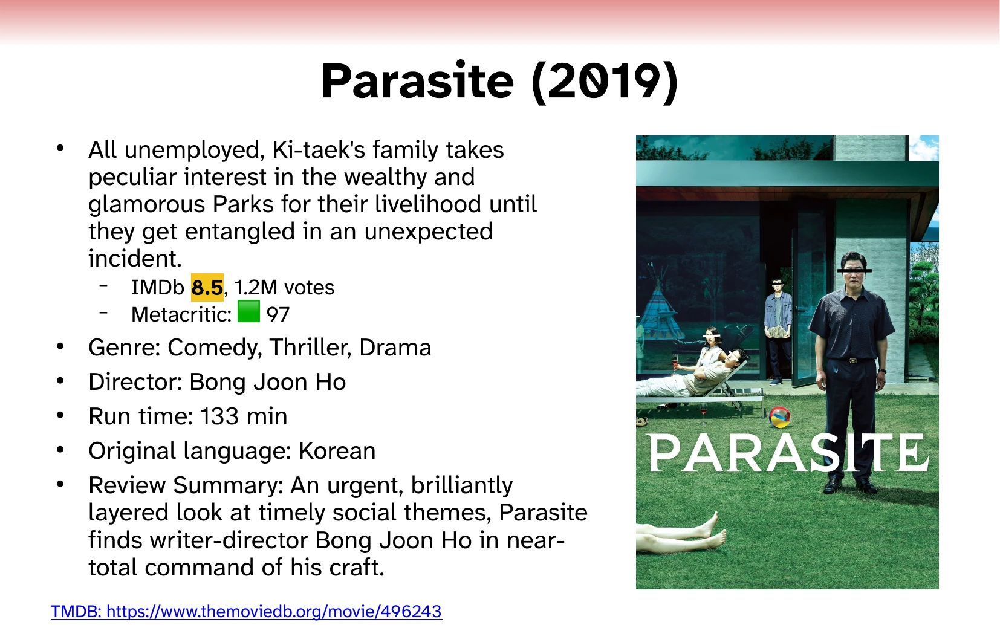
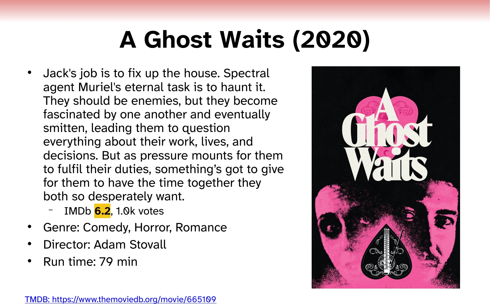

# Movie Slide Maker

Turn a movie title into an editable deck for a classroom, film club, or movie night. Gather the poster, plot, review ratings, and parental guidance, then adapt the slides in LibreOffice Impress.

## See the finished slides

One movie, several useful views. The Jurassic Park examples below show the summary with its TMDB
link, the Common Sense Media overview and category ratings, and selected IMDb guidance.
Click any preview for the full-size image.

<!-- screenshots:begin (managed by screenshot-docs) -->
<table>
  <tr>
    <td width="50%"><a href="docs/screenshots/movie_slide_jurassic_park.webp"></a><br><strong>Movie summary</strong></td>
    <td width="50%"><a href="docs/screenshots/guidance_csm_overview.webp"></a><br><strong>CSM overview</strong></td>
  </tr>
  <tr>
    <td width="50%"><a href="docs/screenshots/guidance_csm_categories.webp"></a><br><strong>CSM categories</strong></td>
    <td width="50%"><a href="docs/screenshots/guidance_imdb.webp"></a><br><strong>IMDb guidance</strong></td>
  </tr>
</table>

<p><strong>More movies, the same workflow.</strong> Crowded ratings, a non-English original language, and different provider coverage.</p>

<table>
  <tr>
    <td width="50%"><a href="docs/screenshots/movie_slide_her.webp"></a><br><strong>Her (2013)</strong></td>
    <td width="50%"><a href="docs/screenshots/movie_slide_cooties.webp"></a><br><strong>Cooties (2014)</strong></td>
  </tr>
  <tr>
    <td width="50%"><a href="docs/screenshots/movie_slide_parasite.webp"></a><br><strong>Parasite (2019)</strong></td>
    <td width="50%"><a href="docs/screenshots/movie_slide_a_ghost_waits.webp"></a><br><strong>A Ghost Waits (2020)</strong></td>
  </tr>
</table>
<!-- screenshots:end -->

The text and tables remain editable in the ODP. Copy individual slides into a lecture or club
presentation; the 28 by 17.5 cm page size and Atkinson Hyperlegible Next font match the teaching
template.

## From title to screening

- **Introduce the film:** poster, plot, director, genres, running time, and available review scores.
- **Prepare the audience:** CSM age guidance, warning and positive-content ratings, and IMDb examples.
- **Keep sources distinct:** IMDb, Rotten Tomatoes, and Metacritic stay labeled; guidance scales
  retain their provider's meaning.
- **Make it yours:** edit native slide text and tables, follow the source links, or copy pages into
  an existing deck.

Ratings adapt to the space available. Non-English original languages are named when known.
Absent facts are omitted, and handled guidance-source failures produce an explicit notice rather
than an assurance that the film contains no upsetting material.

## Quick start

The current setup targets **macOS, Python 3.12, and LibreOffice Still**. Follow
[docs/INSTALL.md](docs/INSTALL.md) for the dependencies, Atkinson Hyperlegible Next font, and your
TMDB v4 read token. Once installed, you do not need to write code.

Live websites can change or block requests. Some guidance error paths still need hardening;
the [repository audit](docs/active_plans/audits/repository_audit_2026_11_17.md) records the known
limitations. Review source guidance before a screening. A usable poster is required; alternate
TMDB posters are tried if the primary image fails.

Open Terminal in the project folder:

```bash
source source_me.sh
python3 make_movie_slide.py
```

At the prompt, enter:

```text
tt0107290
```

This selects Jurassic Park directly. A title such as `Jurassic Park (1993)`, an IMDb URL, or a TMDB
URL also works; an ambiguous title opens a numbered selection menu.

The result is **`jurassic_park_1993.odp`** in the project folder. Open it in LibreOffice Impress:
the summary comes first, followed by the available parental-guidance pages. Longer guide tables
continue onto another slide so the text stays readable.

## Where the information comes from

| Source | What it adds |
| --- | --- |
| TMDB | Poster, plot, title, year, genres, runtime, director, original language, and movie link |
| IMDb | Review score, vote count, and Parents' Guide severity labels and examples |
| Rotten Tomatoes | Critics' Tomatometer, audience Popcornmeter, and critics consensus |
| Metacritic | Metascore |
| Common Sense Media | Recommended age, overview, warning categories, and positive-content categories |

Posters come from TMDB. Guidance providers keep separate slides and rating scales. A missing
language does not imply English, and an original-language label says nothing about subtitles or
dubbing in your viewing copy.

## Compare several films

Build the example review deck without terminal input:

```bash
source source_me.sh && python3 -m slide_maker.review_deck < /dev/null
```

It requests Her (2013), Cooties (2014), It (2017), Parasite (2019), and A Ghost Waits (2020), in that
order. Each accepted movie gets a summary and its available guidance pages.

Open `output_smoke/review_deck.odp`; per-page PNGs are in
`output_smoke/review_deck_pages/`. Full input forms, outputs, and failure behavior are in
[docs/USAGE.md](docs/USAGE.md).

## Find your next step

| I want to... | Read |
| --- | --- |
| Install the tools and add a TMDB token | [docs/INSTALL.md](docs/INSTALL.md) |
| Try another input or understand the output | [docs/USAGE.md](docs/USAGE.md) |
| Understand the slide design preferences | [docs/HUMAN_GUIDANCE.md](docs/HUMAN_GUIDANCE.md) |
| Run integration checks | [docs/E2E_TESTS.md](docs/E2E_TESTS.md) |
| See recent changes | [docs/CHANGELOG.md](docs/CHANGELOG.md) |
| Learn about the maintainer | [docs/AUTHORS.md](docs/AUTHORS.md) |

The runtime design comes from [template/movie_slide_template.pptx](template/movie_slide_template.pptx).
The [archived plan](docs/archive/movie_slide_generator_plan.md) and
[source probe report](docs/active_plans/audits/movie_source_probe_report.md) preserve development
context. `SLIDE_ARTIFACTS/` is local comparison material, not a runtime dependency.

## License

The software is available under the [MIT License](LICENSE.MIT).
