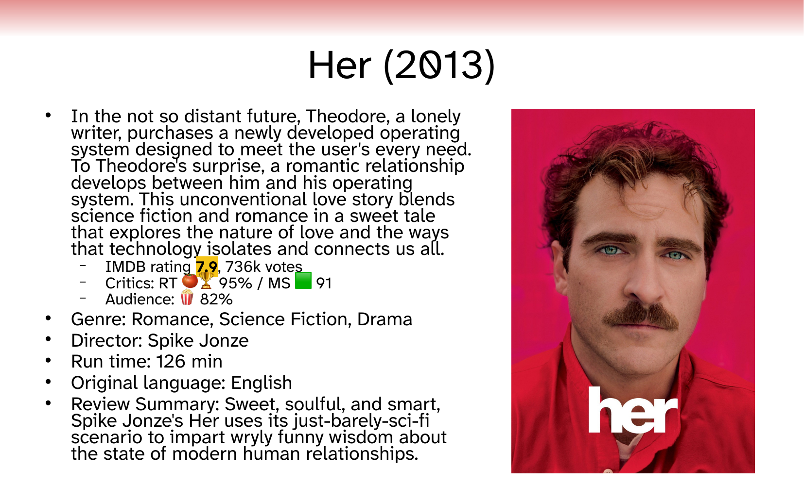
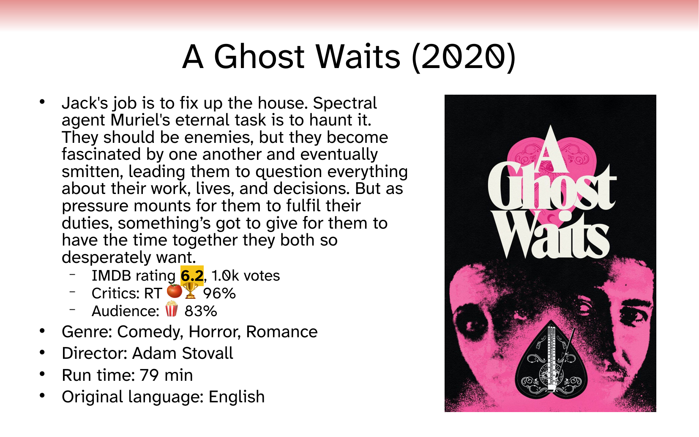

# Movie Slide Maker

Create editable movie introduction slides for teaching from live metadata and ratings. Each slide adapts to missing information, shows the original language, and uses Atkinson Hyperlegible Next.

The macOS workflow produces validated LibreOffice Impress presentations. Live verification on
2026-10-16 produced all five default movies, including a slide without a Metascore or review summary.

## Screenshots

Her shows the full layout; A Ghost Waits shows how unavailable fields disappear while the remaining
movie details stay useful. Both are live captures from 2026-10-16, with posters supplied through
TMDB. Ratings and provider coverage can change.

<!-- screenshots:begin (managed by screenshot-docs) -->


<!-- screenshots:end -->

## From identity to lecture slide

The project is designed for instructors who introduce films in lecture decks and want current
metadata without manually reconciling several movie sites. One movie identity flows through a
committed teaching template while each provider remains responsible for its own data.

- Accept a title and year, IMDb id or URL, or TMDB id or URL, with cross-provider identity checks.
- Combine TMDB metadata and poster art with available IMDb, Rotten Tomatoes, and Metacritic ratings.
- Highlight IMDb scores and compact vote counts; distinguish critic and audience ratings.
- Show one original language when known and use Atkinson Hyperlegible Next throughout.
- Omit missing fields, retain useful information when a source fails, and expand text without a poster.
- Produce editable 28 by 17.5 cm slides and validate content and geometry after ODP conversion.

The resulting slide is organized around a centered `Title (Year)` heading, a teaching outline with
plot and rating context, and an aspect-preserving poster. The permanent runtime design authority is
[`template/movie_slide_template.pptx`](template/movie_slide_template.pptx).

## Quick start

The first-success path needs Bash, Python 3.12, the configured TMDB token, Atkinson Hyperlegible Next,
and the LibreOffice and Python dependencies in [docs/INSTALL.md](docs/INSTALL.md). Run the sole root CLI:

```bash
source source_me.sh
python3 make_movie_slide.py
```

Enter `tmdb:152601` for Her (2013). An explicit ID avoids the selection menu that a title search
can produce. The final progress message names the generated `her_2013.odp` in your current directory.
Open it in LibreOffice Impress to review or edit the slide. The scratch PPTX is removed only after
ODP validation succeeds.

You can also enter an IMDb URL such as `https://www.imdb.com/title/tt0316654/` for Spider-Man 2;
see [docs/USAGE.md](docs/USAGE.md) for the supported input forms.

## Build the review deck

The permanent batch entry needs no terminal input. It resolves five built-in movies through the
same live provider and presentation path:

```bash
source source_me.sh && python3 -m slide_maker.review_deck < /dev/null
```

The default order is `Her (2013)`, `Cooties (2014)`, `It (2017)`, `Sinners (2025)`, and
`A Ghost Waits (2020)`. Missing provider data reduces the content of a slide without excluding the
movie. The products are `output_smoke/review_deck.odp` and retained page PNGs under
`output_smoke/review_deck_pages/`.

## Live data contract

The finished workflow uses current data gathered during each run:

| Source | Available information |
| --- | --- |
| TMDB | Title, year, plot, genres, runtime, director, original language, ids, and poster |
| IMDb | Rating and vote count |
| Rotten Tomatoes | Tomatometer, Popcornmeter, and critics consensus |
| Metacritic | Metascore and display band |

TMDB access requires a v4 read token. Copy `tmdb_key_sample.yml` to the ignored `tmdb_key.yml` and
replace the placeholder with your token before running live provider or pipeline work. Provider
requests share one polite HTTP policy with browser-like headers, randomized delay, timeout, and a
bounded retry for HTTP 403 or 429.

## Project status and limits

- Missing metadata is omitted; unavailable language data does not imply English or subtitles.
- The repository currently targets macOS, Python 3.12, LibreOffice Still, and Atkinson Hyperlegible Next.
- Live provider markup and values can change. Direct E2E scripts validate identity, available fields,
  and plausible ranges instead of freezing current ratings.
- `SLIDE_ARTIFACTS/` is ignored local material for planning and comparison. It is not distributed or
  required at runtime; the extracted template is committed instead.

Generated acceptance evidence includes normal and long-text renders at
`output_smoke/visual_accept/her_2013.png` and
`output_smoke/visual_accept/her_2013_long_text.png`, plus the live review deck and its per-page PNGs.

## Documentation

- [docs/INSTALL.md](docs/INSTALL.md) - Python, LibreOffice, Poppler, font, and token setup.
- [docs/USAGE.md](docs/USAGE.md) - single-movie input forms, batch execution, outputs, and failures.
- [docs/HUMAN_GUIDANCE.md](docs/HUMAN_GUIDANCE.md) - metadata, language, and typography principles.
- [docs/E2E_TESTS.md](docs/E2E_TESTS.md) - integration checks and execution model.
- [docs/CHANGELOG.md](docs/CHANGELOG.md) - changes and dated verification evidence.
- [docs/AUTHORS.md](docs/AUTHORS.md) - maintainer background and project context.

For implementation history, see the
[archived plan](docs/archive/movie_slide_generator_plan.md) and
[source probe report](docs/active_plans/audits/movie_source_probe_report.md).

## License

This software is available under the [MIT License](LICENSE.MIT.md).
