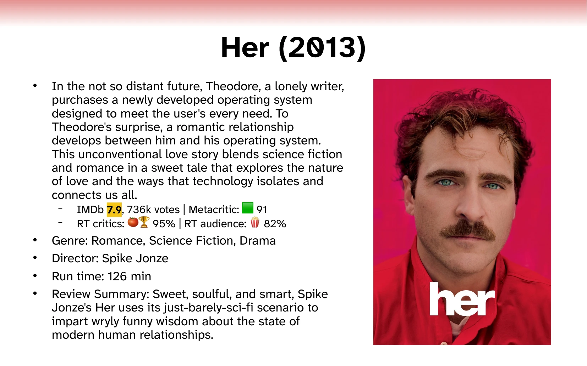
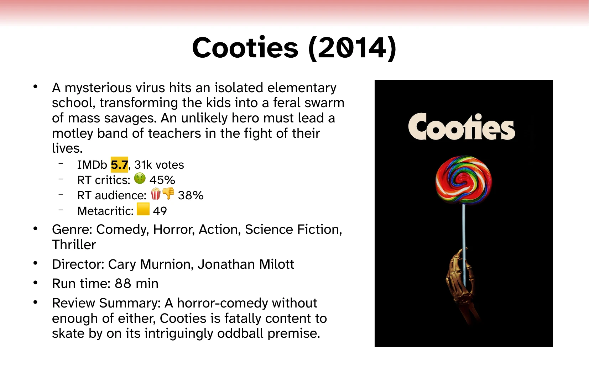
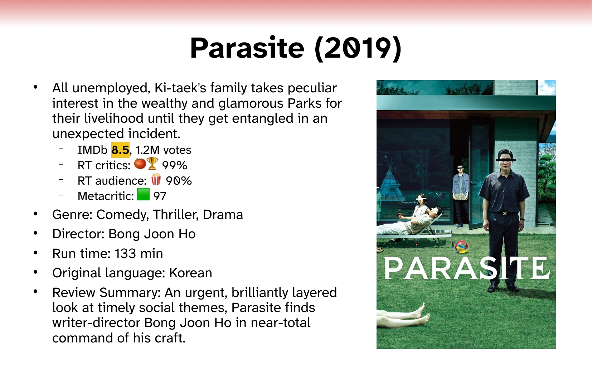
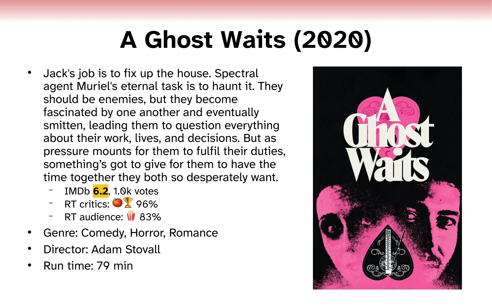

# Movie Slide Maker

Make a movie summary slide for a film club, classroom, presentation, or movie night. Enter a title to gather the poster, plot, and ratings into one editable slide.

Introduce a film, start a discussion, or help a group choose what to watch without collecting details
from several websites. Open the finished slide in LibreOffice Impress to edit it for your audience.
Once installed, making a slide means running a command and entering a movie; you do not write code.
The current setup requires a Mac and some Terminal steps, described below.

## Screenshots

Click any preview to see the full-size slide. These live examples from 2026-10-16 show different
amounts of plot, ratings, and review text. Parasite shows the Korean original-language label;
A Ghost Waits has no Metascore or review summary.
Posters come from TMDB. Ratings and provider coverage can change.

<!-- screenshots:begin (managed by screenshot-docs) -->
<table>
  <tr>
    <td width="50%">
      <a href="docs/screenshots/movie_slide_her.webp"></a><br>
      Her (2013)
    </td>
    <td width="50%">
      <a href="docs/screenshots/movie_slide_cooties.webp"></a><br>
      Cooties (2014)
    </td>
  </tr>
  <tr>
    <td width="50%">
      <a href="docs/screenshots/movie_slide_parasite.webp"></a><br>
      Parasite (2019)
    </td>
    <td width="50%">
      <a href="docs/screenshots/movie_slide_a_ghost_waits.webp"></a><br>
      A Ghost Waits (2020)
    </td>
  </tr>
</table>
<!-- screenshots:end -->

## From movie title to slide

Use a slide to introduce a screening, compare films for a club, add context to a talk, or share a
recommendation. The same layout works with a full set of ratings or just the details available.

- Find a movie by title and year, or paste its IMDb or TMDB link.
- Bring together poster art, plot, genre, director, and running time.
- Compare available IMDb, Rotten Tomatoes, and Metacritic scores, with critic and audience ratings labeled.
- Show the original language for non-English films when known.
- Leave out unavailable details so the slide stays useful when a source has gaps.
- Edit the finished slide in LibreOffice Impress and copy it into your presentation.

Each slide has a bold, centered title, a movie summary with ratings, and a poster.
Ratings use separate rows when space allows and share rows on crowded slides.
Text uses Atkinson Hyperlegible Next on a 28 by 17.5 cm slide. The layout comes from
[`template/movie_slide_template.pptx`](template/movie_slide_template.pptx).

## Quick start

First, follow [docs/INSTALL.md](docs/INSTALL.md) to install Python 3.12, LibreOffice, the font, and
the other requirements, then add your TMDB access token (the credential used to retrieve movie details).
After this one-time setup, open Terminal in the downloaded project folder and run:

```bash
source source_me.sh
python3 make_movie_slide.py
```

At the movie prompt, enter `Her (2013)`. If several matches appear, choose the intended movie from
the numbered list. You can also enter `tmdb:152601` to select this film directly.
When the command finishes, open `her_2013.odp` in the project folder with LibreOffice Impress.
You now have an editable movie summary slide to use or copy into another presentation.

You can also enter an IMDb URL such as `https://www.imdb.com/title/tt0316654/` for Spider-Man 2;
see [docs/USAGE.md](docs/USAGE.md) for the supported input forms.

## Build the review deck

The permanent batch entry needs no terminal input. It resolves five built-in movies through the
same live provider and presentation path:

```bash
source source_me.sh && python3 -m slide_maker.review_deck < /dev/null
```

The default order is `Her (2013)`, `Cooties (2014)`, `It (2017)`, `Parasite (2019)`, and
`A Ghost Waits (2020)`. Missing provider data reduces the content of a slide without excluding the
movie. The products are `output_smoke/review_deck.odp` and retained page PNGs under
`output_smoke/review_deck_pages/`.

## Live data contract

The finished workflow uses current data gathered during each run:

| Source | Available information |
| --- | --- |
| TMDB | Title, year, plot, genres, runtime, director, original language, ids, and poster |
| IMDb | Rating and vote count |
| Rotten Tomatoes | Tomatometer, Popcornmeter, and critics consensus |
| Metacritic | Metascore and display band |

TMDB access requires a v4 read token. Copy `tmdb_key_sample.yml` to the ignored `tmdb_key.yml` and
replace the placeholder with your token before running live provider or pipeline work. Provider
requests share one polite HTTP policy with browser-like headers, randomized delay, timeout, and a
bounded retry for HTTP 403 or 429.

## Project status and limits

- Live verification on 2026-10-16 produced all five default movies, including a slide without a
  Metascore or review summary.
- Missing metadata is omitted; unavailable language data does not imply English or subtitles.
- A poster is required. If the primary TMDB poster fails, alternate posters are tried; if none
  can be retrieved, that movie stops with an error.
- The repository currently targets macOS, Python 3.12, LibreOffice Still, and Atkinson Hyperlegible Next.
- Live provider markup and values can change. Direct E2E scripts validate identity, available fields,
  and plausible ranges instead of freezing current ratings.
- `SLIDE_ARTIFACTS/` is ignored local material for planning and comparison. It is not distributed or
  required at runtime; the extracted template is committed instead.

Generated acceptance evidence includes normal and long-text renders at
`output_smoke/visual_accept/her_2013.png` and
`output_smoke/visual_accept/her_2013_long_text.png`, plus the live review deck and its per-page PNGs.

## Documentation

- [docs/INSTALL.md](docs/INSTALL.md) - Python, LibreOffice, Poppler, font, and token setup.
- [docs/USAGE.md](docs/USAGE.md) - single-movie input forms, batch execution, outputs, and failures.
- [docs/HUMAN_GUIDANCE.md](docs/HUMAN_GUIDANCE.md) - metadata, language, and typography principles.
- [docs/E2E_TESTS.md](docs/E2E_TESTS.md) - integration checks and execution model.
- [docs/CHANGELOG.md](docs/CHANGELOG.md) - changes and dated verification evidence.
- [docs/AUTHORS.md](docs/AUTHORS.md) - maintainer background and project context.

For implementation history, see the
[archived plan](docs/archive/movie_slide_generator_plan.md) and
[source probe report](docs/active_plans/audits/movie_source_probe_report.md).

## License

This software is available under the [MIT License](LICENSE.MIT.md).
